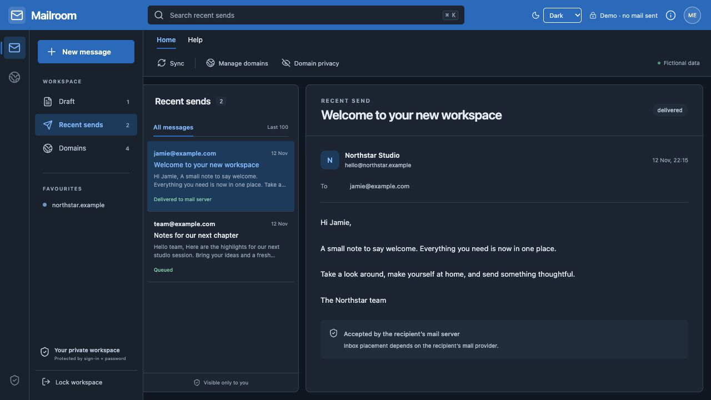

<div align="center">

# ✉️ Mailroom

**Your domains. One quiet workspace.**

An Outlook-inspired email composer for Cloudflare, built to stay private.

[Local setup](#-run-locally) · [ChatGPT Sites](#-run-on-chatgpt-sites) · [MIT license](LICENSE)

</div>


| ✉️ Compose                                     | 🌐 Domains                                              | 🌗 Appearance                                  | 🔒 Private                               |
| ---------------------------------------------- | ------------------------------------------------------- | ---------------------------------------------- | ---------------------------------------- |
| Autosaved draft, Cc/Bcc, review before sending | Choose sender prefixes; hide domains with a right-click | System by default, with Light and Dark choices | Password unlock, server-side credentials |

<details>
<summary><strong>See dark mode</strong></summary>



</details>

Right-click a domain → **Hide / Show**. Masking is cosmetic (`northstar.example` → `*********.example`); the preference is saved in your backend.

_All screenshots use fictional data. This is a sender, not an inbox._

## 🚀 Run locally

Requires **Node.js 22.13+** and npm.

```sh
git clone https://github.com/lisenhuang/mailroom.git
cd mailroom
npm ci
npm run dev
```

Open **http://localhost:5173/demo**. No account or key needed; demo sends are simulated. The demo route is disabled in production builds.

**Connect your Cloudflare account:**

```sh
npm run setup
# Edit .dev.vars: CF_ACCOUNT_ID, CF_EMAIL_TOKEN, TEST_RECIPIENT
npm run db:migrate
npm run dev
```

Open **http://localhost:5173**, use the local sign-in, then unlock with the password in `.mailroom-password`. Save it in your password manager. Restart the server after changing `.dev.vars`.

Only domains enabled for Email Sending and visible to your token appear.

Your scoped API token needs **Account → Email Sending → Edit** (API: Write) and **Zone → Zone → Read** for your domains. [Onboard sending domains in Cloudflare](https://developers.cloudflare.com/email-service/get-started/send-emails/) before general sending. Test mode only permits your configured, verified recipient. Provider plan limits still apply.

## 🤖 Run on ChatGPT Sites

With **Sites available in ChatGPT/Codex**, paste:

```text
Create my own private Mailroom from https://github.com/lisenhuang/mailroom.
Use the Sites skill and this repo's docs/SITES.md. Create a NEW owner-only
Site with D1 binding DB. Keep System / Light / Dark themes. Generate a
strong password and configure server-side secrets securely. Ask for my
Cloudflare account ID, scoped token and verified test address through a
secure setup flow. Never put credentials in chat, source or browser code.
Apply migrations, test access controls, then deploy privately. Show me a
draft before sending any real email. Never make my workspace public.
```

Sites adds owner ChatGPT sign-in before the password screen. See [hosting notes and secret names](docs/SITES.md).

## Small print

Local development binds to loopback. Production requires **owner-only Sites hosting**; do not expose the raw Worker directly. Secrets, databases, and generated passwords are gitignored. Only theme preference is stored in browser local storage.

```text
Browser → private sign-in + password → server → Cloudflare Email API
                                      └──────→ D1 drafts & send history
```

`npm test` · `npm run typecheck` · `npm run build`

React + Vinext · Cloudflare Workers + D1 · [MIT](LICENSE) · [Third-party notices](NOTICE.md)
